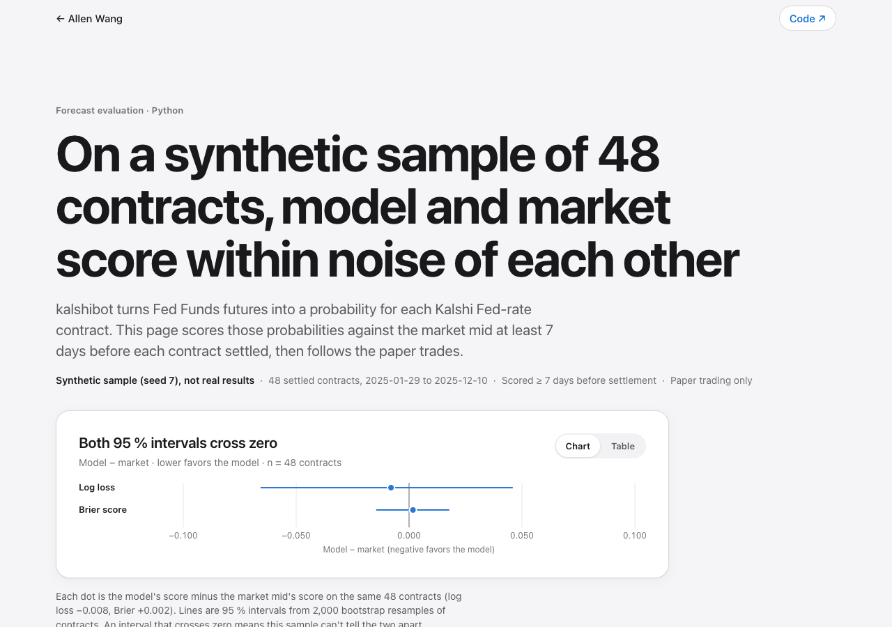

# kalshibot

A trading bot for Kalshi's Fed-rate contracts (series `KXFED`). It turns 30-Day Fed Funds futures into probabilities for each FOMC outcome, compares them with Kalshi's order book, sizes bets with fee-aware fractional Kelly, and scores its model against the market once contracts settle. It runs in paper mode unless you explicitly opt into live trading.

[](https://allenwang0.github.io/kalshibot/)

The screenshot is the evaluation report on synthetic sample data, and every view is labeled SYNTHETIC.

## Highlights

- **Meeting-by-meeting rate model.** Solves each FOMC meeting's expected move from monthly futures averages and chains the meetings from the current target range.
- **Fee-aware sizing.** Shrinks the model toward the market, prices in Kalshi's taker fee, then sizes with fractional Kelly under per-market and total exposure caps.
- **Honest scoring.** Brier score and log loss for model versus market, measured at least 7 days before settlement so the score is not just the market converging.
- **Runs offline.** A recorded-market replay runs a full paper cycle with no keys and no network.
- **Paper by default.** Live trading requires `TRADING_MODE=LIVE` plus API keys, or the bot refuses to start.

## Quickstart

```sh
uv sync
cp .env.example .env
cp data/fed_funds_futures.example.csv data/fed_funds_futures.csv
CURRENT_TARGET_UPPER_BPS=400 uv run python main.py --once --replay tests/fixtures/replay.json
```

This runs one paper cycle against recorded Kalshi responses (fabricated prices) with synthetic futures prices. Tests: `uv run pytest`.

## How it works

1. **Futures to meeting probabilities** (`src/models/fedfunds.py`). Each futures contract implies an average rate for its month (100 minus the price). In a month with an FOMC meeting, the old rate holds through the meeting day and the new rate after it, so the post-meeting rate can be solved from the average. A month with no meeting pins its own rate and anchors its neighbors. Each meeting's expected move is split between the two nearest 25 bp outcomes and chained from the current target range.
2. **Fair value** (`src/strategy.py`). A `KXFED` market resolves YES if the upper bound of the target range is above its strike after the meeting. Fair value is the model probability of every range above the strike.
3. **Book** (`src/book.py`). Kalshi returns resting bids only, so the best YES ask is 100 minus the best NO bid.
4. **Sizing** (`src/risk.py`). The model probability is shrunk toward the ask (`SHRINKAGE`), the ask is raised by the taker fee ($0.07 \cdot P (1 - P)$ per contract), and the Kelly fraction of that bet is scaled by `KELLY_FRACTION`. Each cycle cancels resting orders on the series' markets, reads positions and buys only the gap to the target.
5. **Execution** (`src/executor.py`). Paper mode records fills and fees in SQLite and never sends an order. Live mode sends limit buys through Create Order V2.

Every cycle logs one row per market to SQLite (model probability, best bid and ask, mid, action). When model and mid differ by more than `EDGE_ALERT_THRESHOLD` (0.05) after fees, the bot logs an `EDGE` line, so a paper run can flag trades to place by hand.

Risk limits (`src/config.py`, all overridable from the environment):

| Setting | Default | Meaning |
| --- | --- | --- |
| `KELLY_FRACTION` | 0.20 | Fraction of full Kelly |
| `SHRINKAGE` | 0.5 | Weight on the model's edge over the market |
| `MAX_POSITION_SIZE` | 100.0 | Dollars at cost per market |
| `MAX_TOTAL_EXPOSURE` | 300.0 | Dollars at cost across all markets |
| `MAX_SPREAD_CENTS` | 10 | Skip markets with a wider spread |
| `MIN_ORDER_DOLLARS` | 1.0 | Smallest order |
| `PAPER_BANKROLL` | 1000.0 | Starting cash in paper mode |

## Running it for real

Set in `.env`:

- `CURRENT_TARGET_UPPER_BPS`: upper bound of the current FOMC target range in bp (400 for 3.75 to 4.00 percent).
- `FUTURES_PRICES_PATH`: a CSV with columns `month` (YYYY-MM) and `price`, one row per futures contract month. You supply this; `data/fed_funds_futures.example.csv` shows the format.
- `KALSHI_API_URL`: production `https://external-api.kalshi.com/trade-api/v2` or demo `https://external-api.demo.kalshi.co/trade-api/v2`.
- `KALSHI_API_KEY_ID` and `KALSHI_PRIVATE_KEY_PATH`: live mode only. Keep keys in the git-ignored `keys/`.

```sh
uv run python main.py --once     # one paper cycle on public market data, no keys
uv run python main.py            # loop every LOOP_SECONDS (60)

# Backfill settled markets from the last 8 meetings (you supply the futures archive:
# columns date, month, price, current_upper_bps)
uv run python scripts/backfill.py --prices data/fed_funds_futures_history.csv --meetings 8

uv run python scripts/evaluate.py --update-settlements
uv run python scripts/evaluate.py --html docs/report/index.html
```

## Results

No real contracts have settled in the log yet, so there are no real results. On the synthetic sample (`scripts/make_sample.py`, seed 7) the evaluator prints:

```text
Model Brier 0.164 vs market 0.162 over 48 contracts: the model does not beat the market
log loss: model 0.4774, market 0.4854
settled: 2025-01-29 to 2025-12-10
paper P&L after fees: $78.70 (before fees $101.23, 102 settled fills)
note: synthetic sample data
```

This shows the report format only and says nothing about the model.

## Limitations

- Futures-implied rates include a term premium, so these are risk-neutral probabilities, not forecasts.
- The model assumes one meeting per month and 25 bp steps between the two outcomes nearest the expected move. It puts zero probability elsewhere, which makes it overconfident on far strikes.
- The model has not yet been checked against CME's published worked example.
- Paper fills assume the shown ask and size; real fills can be worse. Maker fees and series-specific fee changes are not modeled.
- Far meetings often have thin books, and the spread filter skips many of them.
- **Live mode spends real money.** It needs `TRADING_MODE=LIVE`, `KALSHI_API_KEY_ID` and `KALSHI_PRIVATE_KEY_PATH`; the bot exits at startup if any is missing, and any other spelling of the mode, such as `live`, is rejected.
- Nothing here shows an edge. Not financial advice. Kalshi and CME data have their own terms.

MIT licensed. See [LICENSE](LICENSE).
