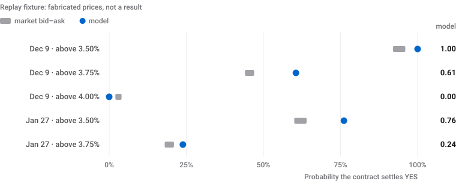

# kalshibot

A trading bot for Kalshi's Fed-rate contracts. It turns Fed Funds futures prices into probabilities for each Fed meeting outcome, compares them with Kalshi's prices, sizes bets after fees, and scores its model against the market once contracts settle.

**[Read the project brief →](https://allenwang0.github.io/kalshibot/)**



## Highlights

<!-- results:start -->
- **Meeting-by-meeting rate model** that solves each Fed meeting's expected move from monthly futures averages.
- **Fee-aware sizing:** shrinks the model 50% toward the market, prices in Kalshi's fee (ceil(0.07·C·P·(1−P)) cents), then bets 0.2 Kelly, capped at $100 per market and $300 in total.
- **Honest scoring:** Brier score and log loss for model versus market, on prices at least 7 days before settlement.
- **Runs offline:** recorded API response shapes replay a full paper cycle with no keys or network.
<!-- results:end -->

## Run it

```sh
git clone https://github.com/allenwang0/kalshibot.git && cd kalshibot
uv sync
cp .env.example .env
cp data/fed_funds_futures.example.csv data/fed_funds_futures.csv
CURRENT_TARGET_UPPER_BPS=400 uv run python main.py --once --replay tests/fixtures/replay.json
```

## How it works

- Each futures contract implies an average rate for its month; in a meeting month the rate after the meeting can be solved from that average.
- Each meeting's expected move is split between the two nearest 25 bp outcomes, chained from the current range.
- A contract's fair value is the probability of every outcome above its strike, compared with Kalshi's best ask.
- Paper mode records fills and fees in SQLite; live mode sends limit orders.

## Limitations

- Futures prices are typed by hand into `data/fed_funds_futures.csv`; nothing checks how old they are.
- Futures-implied probabilities include a term premium, so they are not pure forecasts.
- No real contracts have settled in the log yet, so nothing here shows an edge.
- Paper mode by default; live trading needs `TRADING_MODE=LIVE` plus API keys. Not financial advice.
