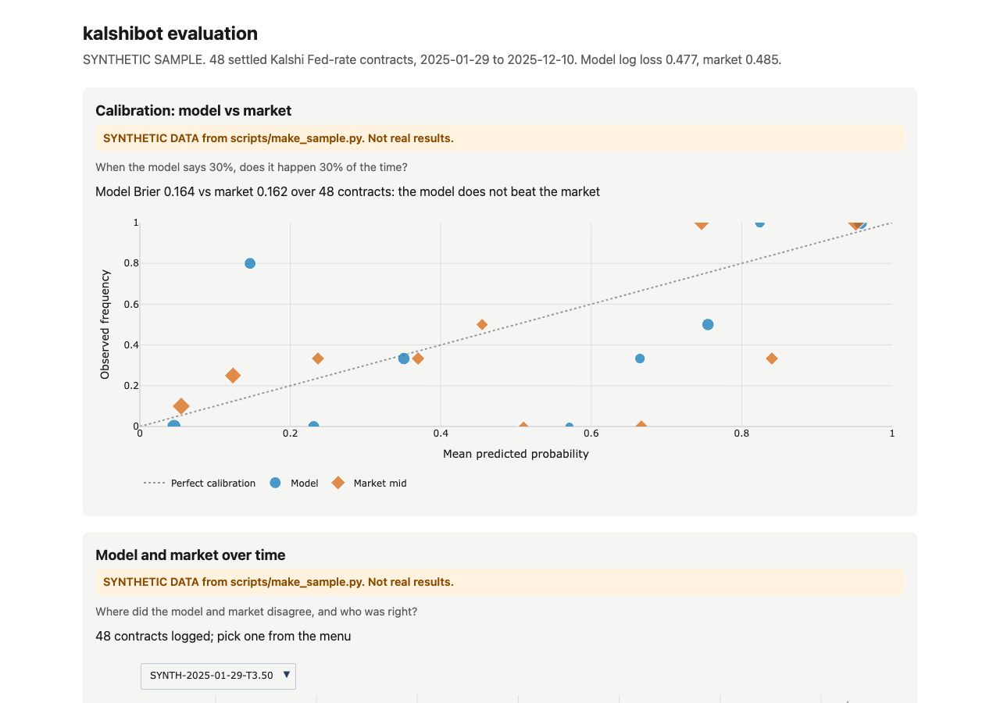

# kalshibot

kalshibot prices Kalshi Fed-rate contracts (series `KXFED`) from 30-Day Fed Funds futures, sizes positions with fee-aware fractional Kelly, and scores its model against the market on settled contracts. It runs in paper mode unless you set `TRADING_MODE=LIVE`.

[](https://allenwang0.github.io/kalshibot/)

The screenshot shows the report built from synthetic sample data (`scripts/make_sample.py`), and every view carries a SYNTHETIC banner. The report is published to GitHub Pages by `.github/workflows/report.yml` after Pages is enabled for the repo.

## How it works

1. Futures prices to meeting probabilities (`src/models/fedfunds.py`). Each futures contract implies an average rate for its month (100 minus the price). In a month with an FOMC meeting, the old rate holds through the meeting day and the new rate holds after it, so the post-meeting rate can be solved from that average. A month with no meeting pins its own rate, which anchors the months around it. Each meeting's expected move is split between the two nearest 25 bp outcomes and chained from the current target range.
2. Fair value per contract (`src/strategy.py`). A `KXFED` market resolves YES if the upper bound of the target range is above its strike after the meeting it closes on. Fair value is the model's probability of every range above the strike.
3. Book (`src/book.py`). Kalshi returns resting bids only. The best YES ask is 100 minus the best NO bid.
4. Sizing (`src/risk.py`). The model probability is shrunk toward the ask (`SHRINKAGE`), the ask is raised by Kalshi's taker fee (0.07 x P x (1 - P) per contract), and the Kelly fraction of that bet is scaled by `KELLY_FRACTION`. Each cycle cancels resting orders on the series' markets (orders on other markets are left alone), reads positions, and buys only the gap to the target.
5. Executor (`src/executor.py`). Paper mode records fills and fees in SQLite and never sends an order. Live mode sends limit buys through Create Order V2.

Every cycle logs one row per market to SQLite: time, ticker, strike, meeting date, model probability, best bid and ask, mid, and the action taken. When the model and the mid differ by more than `EDGE_ALERT_THRESHOLD` (0.05) after the taker fee, the bot also logs an `EDGE` line, so a paper run can flag trades to place by hand.

Risk limits and defaults (`src/config.py`, all overridable from the environment):

| Setting | Default | Meaning |
| --- | --- | --- |
| `KELLY_FRACTION` | 0.20 | Fraction of full Kelly |
| `SHRINKAGE` | 0.5 | Weight on the model's edge over the market |
| `MAX_POSITION_SIZE` | 100.0 | Dollars at cost per market |
| `MAX_TOTAL_EXPOSURE` | 300.0 | Dollars at cost across all markets |
| `MAX_SPREAD_CENTS` | 10 | Skip markets with a wider spread |
| `MIN_ORDER_DOLLARS` | 1.0 | Smallest order |
| `PAPER_BANKROLL` | 1000.0 | Starting cash in paper mode |

## Results

No real settled contracts have been logged yet, so there are no real results. The numbers below come from `python scripts/evaluate.py --db sample.db` on the SYNTHETIC sample (`python scripts/make_sample.py --db sample.db`, seed 7). They show the report's output format and say nothing about the model.

```text
Model Brier 0.164 vs market 0.162 over 48 contracts: the model does not beat the market
log loss: model 0.4774, market 0.4854
settled: 2025-01-29 to 2025-12-10
paper P&L after fees: $78.70 (before fees $101.23, 102 settled fills)
note: synthetic sample data
```

Each contract is scored on the last logged cycle at least 7 days before settlement (`--horizon-days`).

## Setup

```sh
uv sync
cp .env.example .env
```

Uncomment and set in `.env`:

- `CURRENT_TARGET_UPPER_BPS`: the upper bound of the current FOMC target range in basis points (400 for 3.75 to 4.00 percent).
- `FUTURES_PRICES_PATH`: a CSV with columns `month` (YYYY-MM) and `price`, one row per 30-Day Fed Funds futures contract month. You supply this file. `data/fed_funds_futures.example.csv` shows the format; its prices are synthetic.
- `KALSHI_API_URL`: production is `https://external-api.kalshi.com/trade-api/v2`, demo is `https://external-api.demo.kalshi.co/trade-api/v2`. Demo needs demo keys.
- `KALSHI_API_KEY_ID` and `KALSHI_PRIVATE_KEY_PATH`: only for live mode. Keep the key file in `keys/`, which is git-ignored.

## Usage

Offline first run: one paper cycle against recorded market data (Kalshi response shapes with fabricated prices), with no keys and no network:

```sh
cp data/fed_funds_futures.example.csv data/fed_funds_futures.csv
CURRENT_TARGET_UPPER_BPS=400 uv run python main.py --once --replay tests/fixtures/replay.json
```

Paper mode, one cycle (reads public market data only, no keys needed):

```sh
uv run python main.py --once
```

Run continuously, one cycle every `LOOP_SECONDS` (60):

```sh
uv run python main.py
```

Backfill settled markets from the last 8 meetings, so the evaluation has data before months of paper trading. It reads public endpoints only; the futures archive is yours to supply (columns `date`, `month`, `price`, `current_upper_bps`):

```sh
uv run python scripts/backfill.py --prices data/fed_funds_futures_history.csv --meetings 8
```

Evaluate:

```sh
uv run python scripts/evaluate.py --update-settlements   # fetch results for logged markets
uv run python scripts/evaluate.py --html docs/report/index.html
uv run python scripts/evaluate.py --card site/card.json  # refuses synthetic or empty data
uv run python scripts/screenshot.py docs/report/index.html
```

Live mode spends real money. It needs `TRADING_MODE=LIVE`, `KALSHI_API_KEY_ID` and `KALSHI_PRIVATE_KEY_PATH`; the bot exits at startup if any is missing. Any other spelling of the mode, such as `live`, is rejected. A `--once` run whose cycle fails on an API or network error exits with code 1.

Tests, lint and types:

```sh
uv run pytest
uv run ruff check . && uv run ruff format --check .
uv run mypy
```

## Limitations

- Futures-implied rates include a term premium, so the model gives risk-neutral probabilities, not forecasts.
- The model assumes one meeting per month and moves in 25 bp steps between the two outcomes nearest the expected move. It puts zero probability on anything else, which makes it overconfident on far strikes.
- The model has not yet been checked against CME's published worked example.
- Paper fills assume the order fills at the ask for the size shown; real fills can be worse.
- Fees use the general taker formula. Maker fees and fee changes for a series are not modeled.
- Thin books are common in far meetings; the spread filter skips many of them.
- Nothing here shows an edge. This is not financial advice.

Kalshi and CME data have their own terms. The report uses public market prices and does not redistribute more than it needs.

## License

MIT. See [LICENSE](LICENSE).
